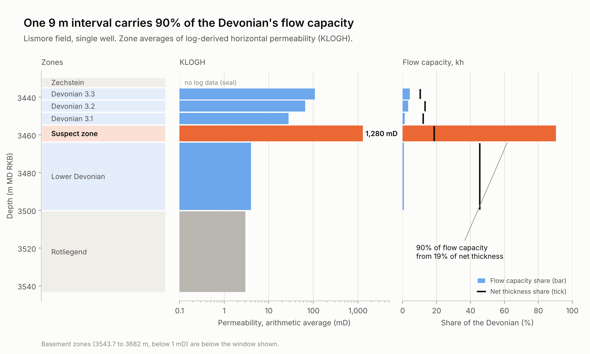
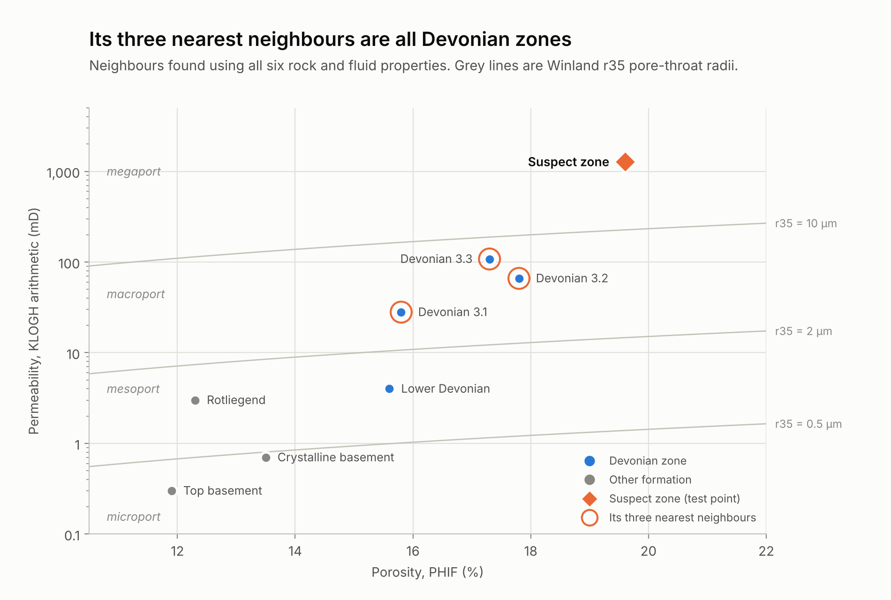
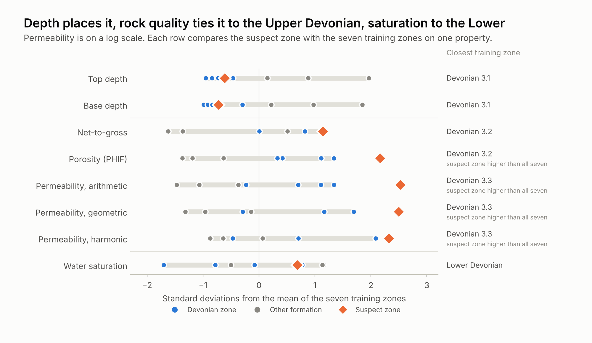

# Locating a thief zone with k-nearest neighbours



A thief zone is a thin, highly permeable layer that takes most of the water injected into a reservoir. This project works through an MSc problem built around one: given the properties of a suspected thief zone and a table of zone averages from a single well, use k-nearest neighbours (kNN) to find where the zone sits, and explain which properties give it away.

**Read the article:** [Locating a thief zone with k-nearest neighbours (PDF)](report/thief-zone-knn.pdf) · **Run the analysis:** [thief-zone-knn.ipynb](thief-zone-knn.ipynb) · [view on nbviewer](https://nbviewer.org/github/ser-arthur/thief-zone-knn/blob/main/thief-zone-knn.ipynb)

## The answer

**The suspected thief zone is in the Devonian, in the 9.1 m interval between Upper Devonian zone 3.1 (base 3454.7 m MD RKB) and the Lower Devonian (top 3463.8 m).**

- **The data places it before any model runs.** The table's Devonian row should be an average of the Upper and Lower Devonian, yet averaging those two gives 31 mD against the 263 mD reported. The difference comes from a 9.1 m interval between them with no row of its own. Back-calculating that interval from the Devonian row gives 1284 mD against the 1280 mD given for the suspect zone.
- **kNN agrees.** With formation names as labels and the table's seven non-overlapping zones as training data, kNN places the zone in the Devonian in every feature view, at k = 1, 3 and 5, and in all 60 configurations of a robustness check.
- **Which properties indicate it.** Depth fixes the position next to Devonian 3.1. Permeability, porosity and net-to-gross tie it to the Upper Devonian zones, and its porosity and permeability are higher than in any zone in the well. Water saturation matches the Lower Devonian, the unit directly below.
- **It behaves like a thief zone.** It holds 19% of the Devonian's net thickness and 90% of its flow capacity, and it is 46 times as permeable as the zone above and 320 times the zone below.

<p>
  
  
</p>

## Approach

1. **Read the table before modelling.** Recompute every parent row from its children. This reproduces the Upper Devonian, reveals the unnamed interval behind the Devonian row, and shows which rows must stay out of training to avoid leakage.
2. **Set up kNN as the problem describes.** Training data, labels and test point are explicit in the code; permeability is log-transformed and the scaler sees training rows only.
3. **Separate what each property says.** Three feature views, a property-by-property comparison and a drop-one-property test.
4. **Check the thief-zone claim with reservoir engineering.** Flow and storage capacity per layer, a stratigraphic modified Lorenz plot, permeability contrast and Winland pore-throat radius.
5. **Test robustness and state the limits.** 60 modelling configurations and a hold-out check on the seven training zones.

## Repository

```
├── thief-zone-knn.ipynb        Analysis notebook: every number and figure in the article
├── thiefzone.py                Data loading, roll-ups, flow metrics and kNN helpers
├── plots.py                    Figures for the notebook, the article and presentation
├── tests/test_thiefzone.py     Checks on the roll-ups, the zonation and the kNN result
├── data/                       The worksheet supplied with the problem
├── figures/                    Notebook figures, in light and dark versions
└── report/
    ├── thief-zone-knn.pdf      The article
    ├── article.md              Article source
    ├── build_report.py         Rebuilds the figures and the PDF from article.md
    ├── style.css, fonts/       Layout and fonts (Source Serif 4 and Space Grotesk, SIL OFL)
    └── figures/                Article figures
```

## Run it

```bash
python -m venv .venv && source .venv/bin/activate
pip install -r requirements.txt
pytest
jupyter notebook thief-zone-knn.ipynb
```

To rebuild the article:

```bash
pip install -r report/requirements.txt
python -m playwright install chromium
python report/build_report.py
```

## Revision note

This repository was reworked in November 2026. The first version, from 2025, classified the zone as thief or non-thief; this version answers the question the problem asked, where the zone is, and checks the data before modelling. The earlier files remain in the commit history.

## References

The article lists its references in full. The main ones are Cardwell and Parsons (1945) for permeability averaging, Gunter et al. (1997) for the stratigraphic modified Lorenz plot, Kolodzie (1980) and Pittman (1992) for the Winland pore-throat equation, Martin et al. (1997) for port-size classes, Li et al. (2023) for thief-zone identification, and Cover and Hart (1967) for nearest-neighbour classification.
