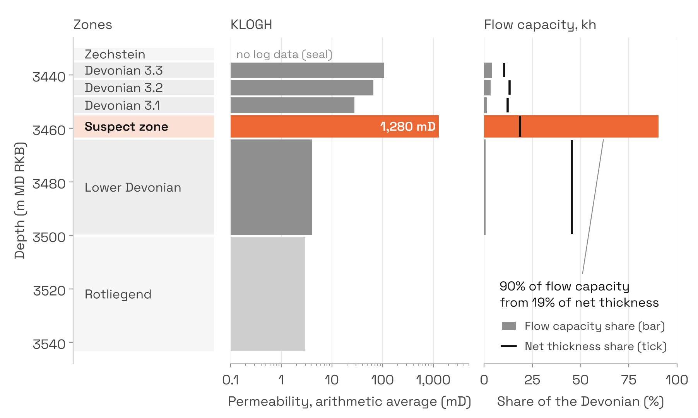
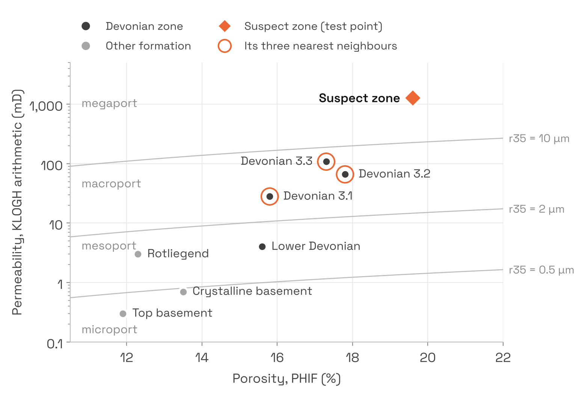
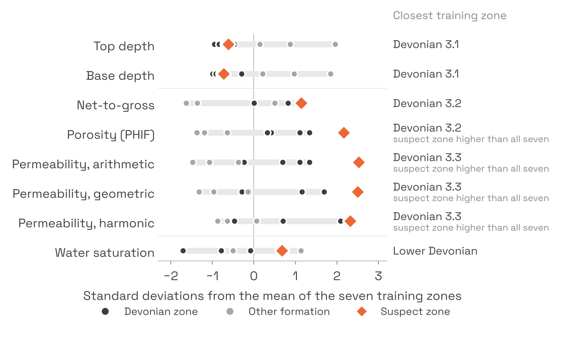
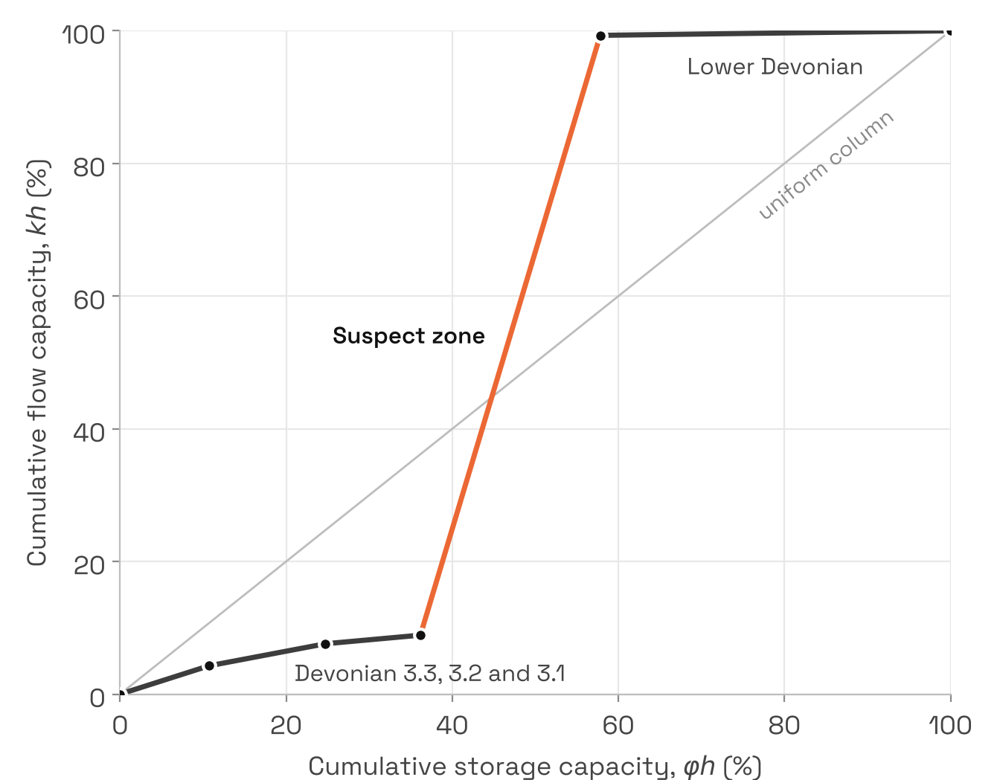

# Locating a thief zone with k-nearest neighbours

### A worked example of checking petrophysical data before machine learning

**Kobby Sintim-Arthur** · November 2026 · Code and data: [github.com/ser-arthur/thief-zone-knn](https://github.com/ser-arthur/thief-zone-knn)

---

**Summary.** A thief zone is a thin, highly permeable layer that takes most of the water injected into a reservoir. This note works through a coursework problem built around one: given the properties of a suspected thief zone and a table of zone averages from a single well, use k-nearest neighbours (kNN) to find where the zone sits. The table's Devonian row should be an average of the two units inside it, the Upper and Lower Devonian. Averaging those two, however, gives a permeability of 31 mD against the 263 mD the row reports. The difference comes from a 9.1 m interval between the two units that has no row of its own, and whose properties, worked back from the Devonian row, match the suspect zone's. A kNN classifier built on the table's seven non-overlapping zones agrees, placing the zone in the Devonian in all 60 configurations tested. Depth fixes its position, its rock properties tie it to the Upper Devonian zones, and its water saturation matches the Lower Devonian, the unit directly below it. A flow-capacity check then confirms the suspicion: the interval is 19% of the Devonian's net thickness and carries 90% of its flow capacity.

---

## 1. The problem

When water is injected to push oil towards producing wells, it follows the easiest path. If one layer is far more permeable than the layers around it, that layer takes most of the water. Water reaches the producers early along it, and the tighter rock either side is left largely unswept. A layer like this is called a thief zone, and finding one early shapes how a field is completed and flooded (Li et al., 2023).

The problem here comes from an MSc module on machine learning for the petroleum industry. Geologists and petrophysicists on a field called Lismore suspected a thief zone somewhere in the strata. They supplied its properties and a table of zone averages from one well, and the task was to use kNN to identify where the zone is, then explain which of its properties indicate that location.

It is a classification exercise, but the most useful step comes before any model: reading the table closely enough to know what each row is. That step answers the question on its own, and it decides how the model has to be set up.

## 2. The data

The worksheet summarises a petrophysical evaluation of one well, with one row per zone (Table 1). Depths are in metres measured depth below the rotary kelly bushing (m MD RKB). N/G, the net-to-gross ratio, is the fraction of a zone that passes reservoir cut-offs. PHIF is porosity and SW is water saturation. KLOGH is permeability derived from logs, averaged over the zone three ways. Flow along the layers is governed by the arithmetic mean, and flow across them by the harmonic mean, which the tightest beds pull down (Cardwell and Parsons, 1945). The geometric mean always lies between the two. Injected water travels along the layers from injector to producer, so this note uses the arithmetic mean to compare zones and to compute flow capacity.

**Table 1.** Zonal summary from the source worksheet.

| Zone | Top (m) | Base (m) | N/G | PHIF | SW | KLOGH arith. (mD) | KLOGH harm. (mD) | KLOGH geom. (mD) |
|---|---|---|---|---|---|---|---|---|
| Zechstein | 3429.4 | 3435.0 | 0 | - | - | - | - | - |
| Devonian | 3435.0 | 3500.2 | 0.692 | 0.168 | 0.899 | 263 | 0.5 | 10 |
| Upper Devonian | 3435.0 | 3454.7 | 0.822 | 0.170 | 0.819 | 65 | 0.5 | 15 |
| Lower Devonian | 3463.8 | 3500.2 | 0.565 | 0.156 | 0.946 | 4 | 0.4 | 1.5 |
| Devonian 3.3 (12) | 3435.0 | 3441.5 | 0.723 | 0.173 | 0.829 | 108 | 32 | 74 |
| Devonian 3.2 (11) | 3441.5 | 3448.0 | 0.923 | 0.178 | 0.760 | 66 | 3 | 26 |
| Devonian 3.1 (10) | 3448.0 | 3454.7 | 0.821 | 0.158 | 0.882 | 28 | 0.2 | 2 |
| Rotliegend | 3500.2 | 3543.7 | 0.133 | 0.123 | 0.850 | 3 | 1 | 2 |
| Crystalline basement | 3543.7 | 3608.0 | 0.723 | 0.135 | 0.975 | 0.7 | 0.3 | 0.4 |
| Top basement | 3608.0 | 3682.0 | 0.051 | 0.119 | 0.973 | 0.3 | 0.2 | 0.2 |

The suspect zone's properties were supplied separately (Table 2).

**Table 2.** Properties given for the suspect zone.

| Zone | Top (m) | Base (m) | N/G | PHIF | SW | KLOGH arith. (mD) | KLOGH harm. (mD) | KLOGH geom. (mD) |
|---|---|---|---|---|---|---|---|---|
| Suspect zone | 3455 | 3464 | 0.923 | 0.196 | 0.939 | 1280 | 48 | 358 |

From the properties given, its arithmetic permeability is about twelve times that of Devonian 3.3, the most permeable of the individual zones.

**Figure 1.** The well's zones from the Zechstein to the Rotliegend, with arithmetic permeability and each Devonian layer's share of flow capacity and net thickness. The suspect zone is shown in the gap it fills.

## 3. Reading the table before modelling

The rows in Table 1 sit at different levels of a hierarchy. Devonian is a formation. Upper and Lower Devonian are units within it, and Devonian 3.3, 3.2 and 3.1 are zones within the Upper Devonian. If the parent rows are averages of their children, then combining the children in the same way should reproduce the parents.

Each parent value would then be a weighted average of its children, Σ<i>w</i><i>i</i><i>x</i><i>i</i> / Σ<i>w</i><i>i</i>, where <i>x</i><i>i</i> is a child's value and <i>w</i><i>i</i> its weight, so each zone counts in proportion to how much of it there is. Gross thickness is base minus top, net thickness is gross thickness times N/G, and pore volume is net thickness times porosity. Net-to-gross is weighted by gross thickness, which makes it total net over total gross. Porosity and the permeability means are averaged over net rock, so they are weighted by net thickness. Water saturation is a fraction of the pore space, so it is weighted by pore volume. The geometric and harmonic means use the same weights in their own forms.

For the Upper Devonian it works. Its three zones cover its full depth range, from 3435.0 to 3454.7 m, and combine to 65.3 mD against the 65 mD reported, with every other column matching to the precision of the table.

The Devonian row does not. An average can never be larger than the largest of its parts, yet the Devonian's arithmetic permeability, 263 mD, is higher than both of its units (65 and 4 mD) and every zone listed under it (108 mD at most). Combining the Upper and Lower Devonian gives only 31 mD. Something more permeable is missing from the table, and the depths show where. The Upper Devonian ends at 3454.7 m and the Lower Devonian begins at 3463.8 m, so 9.1 m of the Devonian has no row of its own.

Subtracting the two units from the Devonian row recovers the properties of that missing interval (Table 3). Averages cannot be subtracted directly, so each is first turned back into a total by multiplying it by its weight: for permeability, permeability times net thickness. The units' totals are taken from the Devonian's, and what remains is divided by the missing interval's own net thickness. The result matches the suspect zone's properties to within rounding. The check also works in reverse: putting the suspect zone into the gap brings the Devonian row back, at 263 mD arithmetic and close on the geometric and harmonic means (9.4 and 0.56 mD against 10 and 0.5), which played no part in the calculation.

**Table 3.** The interval missing from the table, back-calculated from the Devonian row, against the properties given for the suspect zone.

| | Back-calculated | Given |
|---|---|---|
| Top (m) | 3454.7 | 3455 |
| Base (m) | 3463.8 | 3464 |
| N/G | 0.919 | 0.923 |
| PHIF | 0.194 | 0.196 |
| SW | 0.942 | 0.939 |
| KLOGH arithmetic (mD) | 1284 | 1280 |

So the data places the zone before any model is trained. This has two consequences for the model. First, the Devonian and Upper Devonian rows cannot be training examples. They repeat information already held by their children, and the Devonian row contains the suspect zone itself, so a model trained on it would be partly trained on the answer. Second, the answer is now known, so the model can be checked against it.

**Notes on the data.** Three features of the worksheet affect how it is used:

- The Zechstein has an N/G of 0 and no log values, as expected of the evaporites that seal the reservoir. With no rock properties to compare, it is used only in the depth-only view of the model.
- The Rotliegend, which is Lower Permian, is listed beneath the Devonian, the reverse of normal age order. The analysis uses zone names only as labels, so nothing in it depends on their ages.
- The crystalline basement is 72% net yet has only 0.7 mD of permeability. Net here means rock that passes the evaluation's cut-offs, which in basement usually points to fractured or weathered rock, and does not mean the rock will flow. The basement is a kNN training zone but takes no part in the flow analysis, which covers the Devonian only.

## 4. Setting up kNN

kNN classifies a new example by a vote among the *k* most similar examples it has stored (Cover and Hart, 1967). There is no training in the usual sense. Everything depends on what counts as similar, which comes down to the choice of features and how they are scaled.

**Training data.** The seven rows at the bottom of the hierarchy, which do not overlap one another: Devonian 3.3, 3.2 and 3.1, the Lower Devonian (which has no zones listed under it), the Rotliegend, the Crystalline basement and the Top basement. The Devonian and Upper Devonian rows are left out, for the reasons given in Section 3. The Zechstein is added when only depths are used, since its depths are valid even without logs.

**Labels.** The formation each training zone belongs to: Devonian, Rotliegend or Basement, plus Zechstein in the depth-only case. Four training zones carry the label Devonian because they sit inside that formation; the Devonian row itself is not used. Zone names are kept alongside, so the nearest neighbour can also be reported at zone level.

**Test point.** The suspect zone's eight properties.

**Features.** To see what each type of property says, the model is run on three views: stratigraphic (top and base), petrophysical (N/G, PHIF, SW and the three permeability means), and all eight together. Permeability is converted to base-10 logarithms. It spans more than three orders of magnitude, from 0.3 to 1280 mD, and on a linear scale the suspect zone's value would swamp every other property. All features are standardised using statistics from the training rows only, so the test point has no influence on the scaling.

## 5. Where the zone sits

For each view, kNN first puts the properties on a common scale, converting each to standard deviations from the training zones' mean. It then measures the straight-line distance from the suspect zone to every training zone, ranks the zones by that distance, and lets the *k* nearest vote. The formation with the most votes is the prediction. Table 4 lists the distances.

In every view the three nearest zones are all Devonian, so the vote is unanimous at *k* = 1 and *k* = 3. At *k* = 5 it is four Devonian zones to one: the fifth nearest is the Zechstein by depth and the Rotliegend in the other two views. All three views therefore place the suspect zone in the Devonian.

They agree for different reasons. By depth, the nearest zone is Devonian 3.1, directly above the gap, followed by 3.2, 3.3 and the Lower Devonian directly below it. Both zones that bound the gap are among the four nearest. In the petrophysical view, the nearest zone is Devonian 3.3, the best rock in the Upper Devonian, followed by 3.2 and 3.1. Even with depth hidden, the suspect zone looks like Upper Devonian reservoir rock. With all eight properties, the neighbours match the petrophysical view. After scaling, the rock and fluid properties vary much more between the Devonian zones than depth does, so they dominate the distances.

**Table 4.** Distance from the suspect zone to each training zone, in standardised units. The three nearest in each view are in bold.

| Training zone | Formation | Stratigraphic | Petrophysical | All eight |
|---|---|---|---|---|
| Zechstein | Zechstein | 0.55 | - | - |
| Devonian 3.3 | Devonian | **0.43** | **2.40** | **2.44** |
| Devonian 3.2 | Devonian | **0.30** | **3.57** | **3.58** |
| Devonian 3.1 | Devonian | **0.16** | **4.92** | **4.93** |
| Lower Devonian | Devonian | 0.45 | 5.27 | 5.29 |
| Rotliegend | Rotliegend | 1.21 | 6.27 | 6.39 |
| Crystalline basement | Basement | 2.26 | 6.49 | 6.87 |
| Top basement | Basement | 3.64 | 7.81 | 8.62 |

**Figure 2.** Porosity against arithmetic permeability for each training zone and the suspect zone. The ringed zones are the suspect zone's three nearest neighbours, found using all six rock and fluid properties, of which this plot shows two. The grey lines join points of equal pore-throat radius, r35, and divide the plot into the port-size classes of Martin et al. (1997), from microport (narrowest throats) to megaport (widest).

Figure 2 also shows the limit of the method. The suspect zone has higher porosity and permeability than every training zone. Permeability depends less on how much pore space a rock has than on the size of the throats that connect its pores. The Winland equation estimates that size from porosity and permeability as r35, the pore-throat radius at which mercury fills 35% of the pore space in a capillary-pressure test (Kolodzie, 1980; Pittman, 1992). The suspect zone's r35 is about 28 µm, which makes it a megaport rock and the only one in the well, while the best training zone, Devonian 3.3, is a macroport at 7.2 µm. A nearest-neighbour model can only answer with classes it has seen. It can say the zone belongs to the Devonian, but it could never say the rock is unlike anything else in the well. That takes the flow check in Section 7.

## 6. Which properties point to it

Two tests answer this: comparing the suspect zone with the training zones one property at a time (Figure 3), and removing one property at a time from the full model.

**Figure 3.** Each property of the suspect zone compared with the seven training zones, in standard deviations from their mean. The grey bar on each row spans the training zones; where the suspect zone falls outside it, its value is higher than any zone in the well. The right-hand column names the closest training zone on that property alone.

The properties fall into three groups, and together they bracket the zone.

**Depth locates it.** Both top and base are closest to Devonian 3.1, the zone immediately above, and the top is almost as close to the Lower Devonian below. Depth alone puts it on the boundary between the two.

**Rock quality identifies it.** All three permeability means are closest to Devonian 3.3. Its N/G equals that of Devonian 3.2 exactly (0.923), and its porosity is also closest to 3.2. Porosity and every permeability mean are higher than in any zone in the well. That is what a thief zone looks like in a zonal table: rock better than anything around it, by a wide margin.

**Saturation sets it apart from the rock above.** Water saturation is closest to the Lower Devonian (0.939 against 0.946). In fluid terms the zone belongs with the Lower Devonian.

No single property decides the result. Removing any one of the eight still gives Devonian, with Devonian 3.3 as the nearest zone. Rock quality says Upper Devonian, saturation says Lower Devonian, and depth says between them, which is exactly where the gap in the table is.

## 7. Does it behave like a thief zone?

The problem takes the suspicion as given, but it is worth checking. With the suspect zone placed in its gap, the Devonian becomes five layers stacked one above the other. Each layer's flow capacity is its permeability multiplied by its net thickness (*kh*), and its storage capacity is its porosity multiplied by its net thickness (*φh*). Table 5 shows each layer's share of the Devonian total.

**Table 5.** Share of the Devonian's net thickness, storage capacity and flow capacity by layer.

| Layer | Net thickness (m) | KLOGH arith. (mD) | Share of net thickness | Share of storage, φh | Share of flow capacity, kh |
|---|---|---|---|---|---|
| Devonian 3.3 | 4.7 | 108 | 10.4% | 10.7% | 4.3% |
| Devonian 3.2 | 6.0 | 66 | 13.3% | 14.0% | 3.3% |
| Devonian 3.1 | 5.5 | 28 | 12.2% | 11.4% | 1.3% |
| **Suspect zone** | **8.4** | **1280** | **18.6%** | **21.6%** | **90.4%** |
| Lower Devonian | 20.6 | 4 | 45.5% | 42.2% | 0.7% |

The suspect zone holds 19% of the Devonian's net thickness and 22% of its storage, yet 90% of its flow capacity. If the layers flow side by side without crossflow and the fluids have similar mobilities, injected water divides between them in proportion to *kh*. About nine barrels in every ten would go into this 9 m interval. A flood front in a layer advances at a speed proportional to permeability over porosity, so in the suspect zone it would move about ten times faster than in Devonian 3.3, the next best layer. Water would break through along it long before the rest of the Devonian was swept.

**Figure 4.** Stratigraphic modified Lorenz plot of the Devonian (Gunter et al., 1997): cumulative flow capacity against cumulative storage capacity, in stratigraphic order. A layer whose segment is steeper than the diagonal carries more than its share of flow.

On the stratigraphic modified Lorenz plot (Figure 4), the suspect zone is the near-vertical segment, which Gunter et al. (1997) would call a speed zone. The permeability contrasts are just as clear. The zone is 46 times as permeable as the zone above, 320 times as permeable as the zone below, and 41 times the net-weighted average of the other Devonian layers (31 mD). For comparison, Li et al. (2023) used production data from an Iraqi carbonate field to set their thief-zone threshold at 2.8 times the average permeability of the surrounding stratigraphic member. Different reservoirs call for different thresholds, but this zone would clear any threshold of that order many times over.

Two further details support the case. The harmonic mean, 48 mD, is higher than the harmonic mean of any other zone. Because the harmonic mean is pulled down by tight beds, the interval can have no tight beds of any consequence: its high permeability runs through the whole 9 m. The water saturation of 0.939 is unusually high for rock of more than a darcy. That fits a zone already swept by injected water, and it also fits rock near or below the oil-water contact. Within the Devonian, water saturation rises with depth from zone 3.2 (0.76) to the Lower Devonian (0.95), and the suspect zone's 0.94 falls on that trend, so saturation alone cannot tell the two apart.

## 8. How far to trust the result

**Robustness.** The location should not depend on modelling choices. Across 60 configurations, varying the feature view, *k* (1, 3 and 5), the scaler (standard or min-max), the permeability scale (log or linear) and whether the parent rows are wrongly left in the training data, every one places the suspect zone in the Devonian. The nearest zone is always Devonian 3.1 in the stratigraphic view and Devonian 3.3 in the other two.

**Hold-out check.** Each training zone was held out in turn and located from the other six. All four Devonian zones were placed in the Devonian. The Rotliegend cannot be, because removing it leaves no other Rotliegend example, and the two basement zones were not placed reliably because they differ from each other more than either differs from its neighbours. With seven rows, this table works as a reference catalogue for one well. It should not be read as a general-purpose classifier.

**Limitations.** The table holds one well's zone averages, so it cannot show whether the zone is continuous between injectors and producers, which is what turns a permeable layer into a working thief zone. KLOGH is a log model and would normally be calibrated against core. The zone's permeability is also about three times what the porosity trend of the other zones predicts at its porosity (about 390 mD), which could point to coarser grain size or to fractures; core and borehole image logs could tell them apart. The water split assumes no crossflow between layers. Crossflow would spread water into neighbouring layers and soften the effect, though it would not remove it.

**What would confirm it.** Injection and production logging to show which intervals take and give up water, interwell tracer tests, formation pressure tests showing early depletion or pressure support in the zone, and time-lapse saturation logs. If confirmed, the usual responses are conformance treatments such as polymer gels, selective completion or zonal isolation across the interval, and changes to injection rates.

## 9. Three lessons for similar problems

**Read the structure of a summary table before modelling it.** Zonal tables are often nested, with parent rows that average their children. Checking the roll-ups takes minutes. It catches duplicated rows and leakage, and here it answered the question outright.

**Test that the answer survives the modelling choices.** The features, their scaling, the value of *k* and the choice of training rows can each change a kNN result. Here the location held across all 60 combinations. A result that changes with the settings says more about the model than about the reservoir.

**Know what a nearest-neighbour model cannot do.** kNN answers with the classes it has seen and cannot recognise something new. When the test point lies outside the training data, as it does here, pair the model with physics that can.

---

**Data and code.** The worksheet was supplied with the coursework, and the brief is paraphrased here. The repository at [github.com/ser-arthur/thief-zone-knn](https://github.com/ser-arthur/thief-zone-knn) contains the data, a notebook that reproduces every number and figure in this note, and tests covering the roll-ups, the zonation and the kNN result.

## References

Cardwell, W.T. and Parsons, R.L. (1945). Average permeabilities of heterogeneous oil sands. *Transactions of the AIME*, 160, 34-42.

Cover, T. and Hart, P. (1967). Nearest neighbor pattern classification. *IEEE Transactions on Information Theory*, 13(1), 21-27.

Gunter, G.W., Finneran, J.M., Hartmann, D.J. and Miller, J.D. (1997). Early determination of reservoir flow units using an integrated petrophysical method. Paper SPE 38679, SPE Annual Technical Conference and Exhibition, San Antonio.

Kolodzie, S. (1980). Analysis of pore throat size and use of the Waxman-Smits equation to determine OOIP in Spindle Field, Colorado. Paper SPE 9382, SPE Annual Technical Conference and Exhibition, Dallas.

Li, R., Deng, H., Fu, M., Hu, L., Xie, X., Zhang, L. and Guo, X. (2023). Identification method of thief zones in carbonate reservoirs based on the combination of static and dynamic data: a case study from the Cretaceous Mishrif Formation in the H oilfield, Iraq. *Frontiers in Energy Research*, 10, 1043231. https://doi.org/10.3389/fenrg.2022.1043231

Martin, A.J., Solomon, S.T. and Hartmann, D.J. (1997). Characterization of petrophysical flow units in carbonate reservoirs. *AAPG Bulletin*, 81(5), 734-759.

Pittman, E.D. (1992). Relationship of porosity and permeability to various parameters derived from mercury injection-capillary pressure curves for sandstone. *AAPG Bulletin*, 76(2), 191-198.
